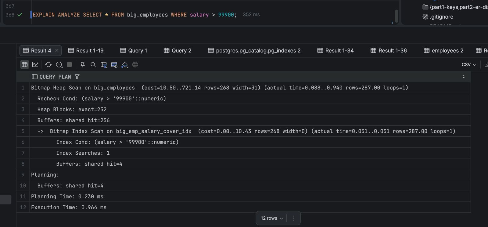

# Lab 8 - SQL Indexes

Абдималик Ернур
PostgreSQL 16

Code is in [8.sql](8.sql), answers also there in comments.

## Answers

**2.1** 2 indexes. employees_pkey (postgres made it by itself because of primary key) and emp_salary_idx that I made.

**2.2** Postgres doesn't make index on foreign key by itself. With index on dept_id the JOIN with departments is faster, WHERE dept_id = 101 is faster, and when you delete a department postgres has to check employees for this dept_id, without index it goes through all table.

**2.3** departments_pkey, employees_pkey, projects_pkey - automatic, from primary keys. emp_salary_idx and emp_dept_idx - I created them.

**3.1** Not really. The index is sorted by dept_id first and salary only inside each dept, so salaries > X are everywhere in the index. For salary only postgres will use emp_salary_idx.

**3.2** Order in WHERE doesn't matter, query 1 and 2 are same for postgres. But order of columns in index matters. (dept_id, salary) is better here because first it finds dept_id with = and then range on salary. With (salary, dept_id) it reads all salary > 50000 and then checks dept_id. So columns with = go first, columns with > < go last.

**4.1**
```
ERROR:  duplicate key value violates unique constraint "emp_email_unique_idx"
DETAIL:  Key (email)=(john.smith@company.com) already exists.
```

**4.2** Yes, it made employees_phone_key:
```
CREATE UNIQUE INDEX employees_phone_key ON lab8.employees USING btree (phone)
```
It's unique B-tree. UNIQUE constraint works through this index.

**5.1** Salaries are already sorted desc in the index, so postgres just reads them in order and doesn't sort again. Good with LIMIT, for example top 10 salaries.

**6.1** It would do Seq Scan - go through every row, do LOWER(emp_name) and compare. Normal index on emp_name won't help because there are original names, not lowercase.

**7.2** Every insert/update/delete also updates all indexes, so writes get slower. Also they take space. And if index is not used or duplicate (like emp_salary_dept_idx) there is no point to keep it.

**8.2** It keeps only rows with budget > 80000, so it's smaller and faster, and other rows don't touch it. But it works only if query condition fits in the index condition, for example budget > 100000 ok, budget > 50000 no.

**8.3**
```
Seq Scan on employees  (cost=0.00..1.06 rows=2 width=522)
  Filter: (salary > '52000'::numeric)
```
Seq Scan. The table has only 5 rows so it's cheaper to just read it all. So postgres doesn't always use the index even if it exists. On big table it used it (challenge 3).

**9.1** Only when you search with = and don't need ranges or sorting. Hash can't do > < BETWEEN or ORDER BY. So B-tree is better most of the time.

**10.1** Hash indexes are the biggest - dept_name_hash_idx and proj_name_hash_idx are 32 kB, all B-tree are 16 kB. Tables are very small so it's just the minimum size, and hash index has more pages from start than B-tree.

## Summary Questions

1. B-tree.
2. Columns often used in WHERE on big tables, foreign keys / JOIN columns, columns in ORDER BY.
3. Small tables, and columns with few different values like true/false. Also tables where you mostly insert and rarely read.
4. Indexes get updated too, automatically. That's why writes are slower. Index can get bloated, then REINDEX helps.
5. EXPLAIN or EXPLAIN ANALYZE. If there is Index Scan / Bitmap Index Scan / Index Only Scan - index is used. If Seq Scan - not.

## Additional Challenges

1. emp_hire_month_idx on year and month of hire_date.
2. emp_dept_email_unique_idx on (dept_id, email).
3. Made big_employees table with 200 000 rows. Query WHERE salary > 99900 used Bitmap Index Scan, execution time 0.964 ms.
4. Covering index big_emp_salary_cover_idx on salary INCLUDE (emp_id). For SELECT emp_id, salary it can do Index Only Scan and doesn't go to the table.

## Screenshot



## Reflection

Indexes make select faster but insert/update slower and take space, so you don't need them on every column. I was a bit surprised that on employees table postgres didn't use the index at all, just Seq Scan, because table is too small. On 200k rows it used the index and query took less than 1 ms. So I think indexes are needed on big tables and on columns that are used a lot in WHERE, JOIN, ORDER BY. B-tree is enough in most cases. And better check with EXPLAIN if index really works.